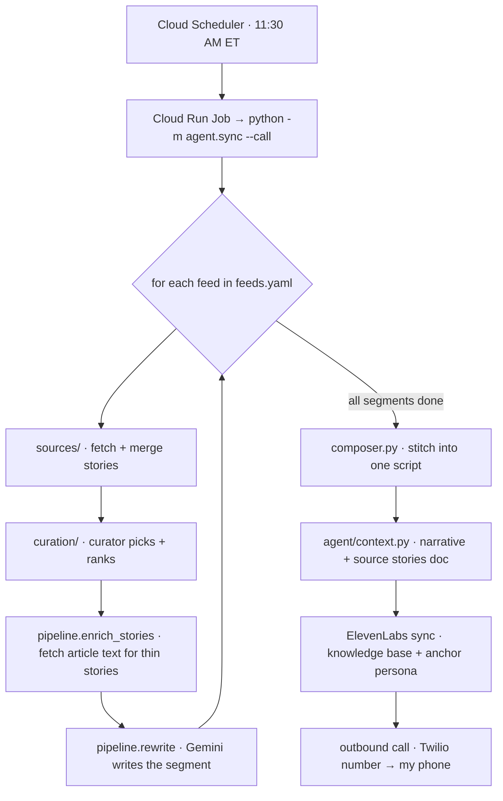
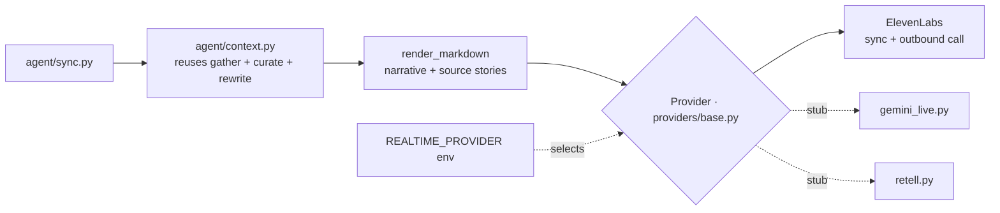
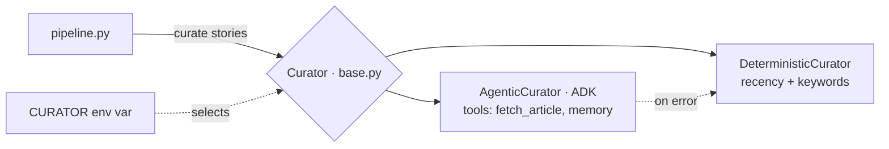
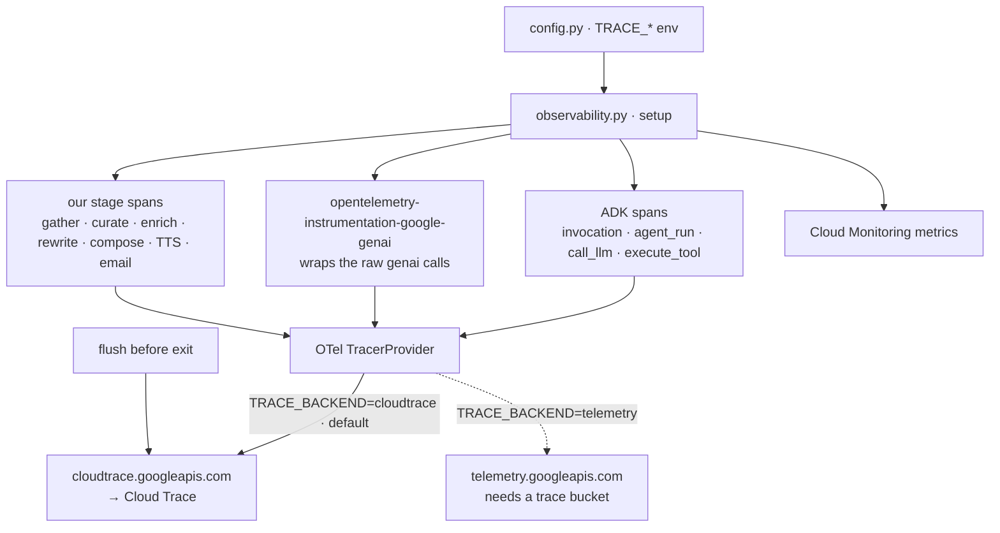
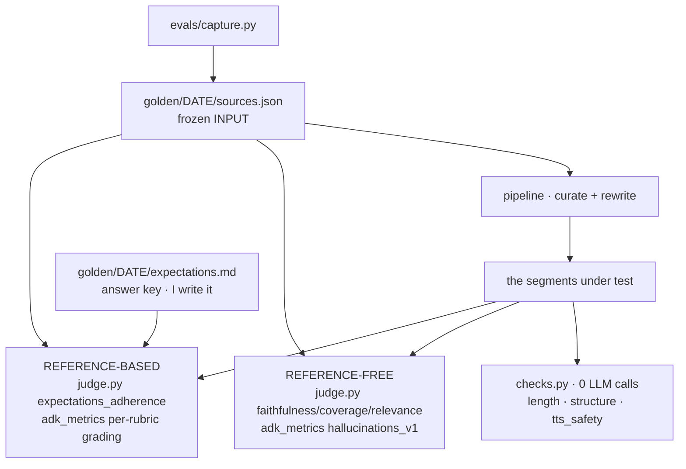

# ARCHITECTURE — Daily_News
`Daily_News` · updated 2026-10-17 · _how the app fits together. Update when the structure changes._

**In one line:** every morning it pulls news from several sources, an LLM rewrites it into a spoken briefing, and a voice agent **phones me** with it and answers follow-up questions.

> The diagram below is [Mermaid](https://mermaid.js.org/). It renders as a graph on GitHub automatically, or in VS Code with the "Markdown Preview Mermaid Support" extension.

## The flow (what happens each run)



**In plain words:**
1. A timer (Cloud Scheduler, 11:30 AM ET) starts the job → runs `python -m agent.sync --call`.
2. It reads the feed list from `feeds.yaml`.
3. For each feed: **fetch** stories from its sources → **curate** (pick the good ones) → **enrich**
   headline-only stories with real article text → **rewrite** into a spoken segment with Gemini.
4. `composer.py` stitches all segments into one script (greeting + transitions + sign-off). A
   segment that came back blank or as a placeholder like "(no output)" is dropped, not spoken.
5. `agent/context.py` packages the script plus the raw source stories into one knowledge doc.
6. That doc is uploaded to the ElevenLabs agent, then ElevenLabs rings my phone. On the call the
   agent reads the briefing and answers follow-ups from the source stories.

`deploy.sh` overrides the image's entrypoint to get this path. The `Dockerfile` still says
`python main.py`, which is the older MP3-by-email path (see below).

### The older path: MP3 by email (`main.py`)

Retired in production but still works locally (`DRY_RUN=1 python main.py`). It runs the same
gather → curate → enrich → rewrite → compose steps, then `synthesize_mp3` (Cloud TTS, Chirp3-HD) →
`send_email` (Gmail) → optional `archive_to_gcs`.

### The two LLM steps, and their temperature

Only two steps call a model in a normal run, and **both are paraphrase-or-judge work, not creative
work** — so both are pinned low. They had no temperature at all until 2026-10-03, which meant they
ran at Gemini's default of 1.0; that is how a `$100,000 H-1B fee` once became a `bond`.

| Step | Model | Env | Default |
|---|---|---|---|
| `curation/agentic.py` — ranks + trims the candidates | `GEMINI_MODEL` (2.5-flash) | `CURATOR_TEMPERATURE` | `0.2` |
| `pipeline.rewrite` — writes the spoken segment | `GEMINI_REWRITE_MODEL` (2.5-pro) | `REWRITE_TEMPERATURE` | `0.2` |

0.2 stops invention but is **not** deterministic — the same frozen golden set still yields a
different story selection and length each run. Export both as `0` when you need two eval runs to be
comparable.

## The voice agent (how the phone call works)

`agent/sync.py` is the production entry point. It reuses the same pipeline, then hands the result
to a voice **provider**.



Same **strategy pattern** as the curator: a `Provider` contract behind `REALTIME_PROVIDER`.
`ElevenLabsProvider` is fully built:
- **`sync()`** uploads today's doc as a new dated knowledge-base document and attaches only that one
  to the agent. It also pushes the host persona from `agent/prompts/anchor.md` as the system prompt
  and re-asserts the `end_call` tool, so the persona lives in git, not the dashboard. Without
  `end_call` the agent could *say* goodbye but never actually hang up.
- **`place_outbound_call()`** asks ElevenLabs to ring `USER_PHONE_NUMBER` from the Twilio number
  imported into ElevenLabs. ElevenLabs holds the Twilio credentials, so this code never talks to
  Twilio directly. ⚠ ElevenLabs answers HTTP 200 with `success=False` for a refused call, so check
  `success`, not the status code.
- **Order matters:** sync first, then call. Dialling first means the agent discusses yesterday's news.
- `create_session()` (browser/signed-URL mode) is still a stub. Gemini Live and Retell are stubs too.

```bash
python -m agent.sync --dry-run      # build + print the doc, touch nothing
python -m agent.sync                # refresh knowledge only
python -m agent.sync --call         # refresh, then ring (what prod runs)
python -m agent.sync --call-only    # ring without rebuilding: tests telephony alone, skips ~2 min of pipeline
```

## How a curator plugs in (the swappable brain)



## Observability (tracing, tokens, cost)

Everything stays on GCP — no LangSmith, no LangChain. ADK already emits OpenTelemetry GenAI spans
for every agent run, model call and tool call; `observability.py` is the bootstrap that points them
at Google Cloud and adds spans for the pipeline's own stages.



One run is one trace. The production (phone) run:

```
daily_news.agent_sync               curator, feeds, provider, stories, outcome
├─ gather_stories (per feed)         → fetch_source per adapter, story counts
├─ feed  name="AI & Tech"
│  ├─ curate                        curation.fallback, adk.session_id
│  │  └─ invocation → agent_run → call_llm / execute_tool      ← ADK's own spans
│  ├─ enrich_stories                enriched
│  └─ rewrite                       gen_ai.request.model + input/output tokens
├─ provider_sync                    provider
└─ outbound_call                    conversation_id, call_sid
```

The `main.py` run has the same middle, under a `daily_news.run` root, and ends with
`compose · synthesize_mp3 · send_email · archive_to_gcs` instead of the last two spans.

**The knobs** (all in `.env.example`):

| Env | Default | What it does |
|---|---|---|
| `TRACE_ENABLED` | on | `0` makes every span helper a no-op |
| `TRACE_BACKEND` | `cloudtrace` | `telemetry` switches to ADK's OTLP endpoint |
| `TRACE_METRICS` | **off** | Cloud Monitoring metric export. Opt-in: spans already carry the token counts, and this exporter throws `UNAVAILABLE` tracebacks intermittently. |
| `TRACE_LOGS` | off | OTel log export (Cloud Run already captures stdout) |
| `TRACE_CONTENT` | on locally, off in Cloud Run | prompt/response text on spans |
| `EVAL_JUDGE_MODEL` | `gemini-2.5-flash` | judge for the ADK eval metrics |
| `EVAL_JUDGE_SAMPLES` | `3` | judge samples per metric per segment (ADK default 5 = 40 calls/run) |

**Two things that will bite you:**
- **Flush or lose them.** The exporter batches; a Cloud Run Job exits first. Every entry point calls
  `observability.flush()` in a `finally`.
- **`TRACE_BACKEND=telemetry` can look healthy and export nothing.** It returns HTTP 200 but the
  spans are unreadable until the project has a trace bucket (`_Trace bucket not found in project`).
  That's why `cloudtrace` is the default.

## Evals: two kinds of grading, and what each needs

A golden set is **frozen input**, not an answer key — `sources.json` is captured news that can't
change between runs, so a score change means the code changed, not the news. `expectations.md` is
the separate, hand-written answer key. That distinction decides which metrics can run at all.



- **Reference-free** compares the segment to the **sources**. Needs no answer key, so it works on a
  freshly captured day with no writing from me.
- **Reference-based** compares it to **my rules**. Skipped automatically when `expectations.md` is
  absent. ⚠ A `capture.py` stub answer key is worse than none: it is non-empty, so adherence grades
  against nothing and returns a false **1.00**. Delete the stub on a day you haven't written one.
- `adk_metrics.py` is a thin adapter — ADK owns the prompts, the sampling and the scoring; the only
  logic in this repo is `parse_expectations()`, which turns my bullets into one rubric per rule.

```bash
python -m evals.capture --name YYYY-MM-DD                    # freeze today's sources
python -m evals.run --golden DATE --curator agentic           # my judges only
python -m evals.run --golden DATE --curator agentic --adk-metrics   # + Google's
python -m evals.compare --golden DATE                        # deterministic vs agentic
```

## Where things live
| Path | Its job |
|---|---|
| `agent/` | **The production entry point.** `sync.py` (sync + call), `context.py` (builds the knowledge doc), `providers/` (ElevenLabs built; Gemini Live + Retell stubs), `prompts/anchor.md` (the host persona). |
| `main.py` | Older entry point (MP3 by email). Orchestrates, then TTS + email + archive. Still the `Dockerfile` default. |
| `pipeline.py` | The core loop: gather → curate → enrich → rewrite → compose. Shared by both entry points. |
| `config.py` | Loads settings (env vars) + the feed list from `feeds.yaml`. |
| `feeds.yaml` | **The knobs.** Topics, sources, word budgets. Edit here to change what the briefing covers. |
| `sources/` | One adapter per source, all returning a `Story`. In use: `tldr_web`, `hackernews`, `rss` (publishers' own feeds), `stocks`. Still in the code but no longer used by any feed: `google_news_rss` (Google News 503s datacenter IPs) and `gmail_newsletter`. |
| `curation/` | The swappable brain: `deterministic.py` + `agentic.py`, both behind `base.Curator`. |
| `composer.py` | Joins segments into the final spoken script; drops blank/placeholder segments. |
| `memory.py` | Cross-run memory (what past digests covered) — used by the agent. |
| `prompts/` | Per topic: a rewrite prompt (how it *sounds*) + a `curate_*.md` (how it's *ranked*), plus `_shared_style.md`. |
| `evals/` | Quality testing: `capture.py` freezes input, `checks.py` code checks, `judge.py` my 3 LLM judges, `compare.py` A/B, `golden/` the frozen days. |
| `evals/adk_metrics.py` | Google's own judges (ADK `hallucinations_v1` + per-rubric expectations), behind `--adk-metrics`. |
| `observability.py` | Tracing bootstrap + span helpers. One import per entry point. |
| `adk_apps/` | Dev-loop only, not part of a run: exposes the curator to `adk web` so its turns can be watched live. See below. |
| `deploy.sh` / `Dockerfile` | Package + ship to Cloud Run. `deploy.sh` overrides the entrypoint to `agent.sync --call` and owns the schedule. |

## Watching the curator live (`adk web`)

`adk web` discovers agents by scanning a directory for subfolders exposing a module-level
`root_agent`. The real curator is built *inside* `AgenticCurator._run_agent()`, once per feed, so
there is nothing for the dev UI to find — `adk_apps/curator/` is a thin adapter that builds the same
agent from the same `_INSTRUCTION` and the same tools.

```bash
adk web adk_apps                                  # → http://127.0.0.1:8000, pick "curator"
ADK_WEB_FEED="US Headlines" adk web adk_apps      # load a different feed's persona
python adk_apps/dump_candidates.py --feed "US Headlines" [--golden DATE]   # paste-ready input
```

It shows the **curator only** — the rewrite and every judge are raw `google-genai` calls, not
agents, so they never appear here. Use Cloud Trace for a whole run.

## Key ideas (the patterns)
- **`Story`** — one normalized shape every source returns, so the rest of the app doesn't care where news came from. (*adapter pattern*)
- **`Source`** — a contract: any source implements `fetch() → [Story]`. Add one = new file in `sources/`.
- **`Curator`** — a contract for the brain: `curate(stories) → chosen stories`. Two versions, picked by `CURATOR`. (*strategy pattern*)
- **`Provider`** — the same contract again for the voice agent: `sync(ctx)`, picked by `REALTIME_PROVIDER`. (*strategy pattern*)
- **`feeds.yaml`** — config, not code. New topic = new entry here.
- **Evals** — grade a segment two ways: vs the sources (no answer key needed), and vs my hand-written `expectations.md`.
- **Fail soft on anything non-essential.** A dead source is skipped, the agentic curator falls back
  to deterministic, a blank segment is dropped instead of spoken, and GCS archiving and all tracing
  swallow their own errors. The briefing ships.

## How to extend
- **Add a source** → new file in `sources/` implementing `fetch()`, register it, reference it in `feeds.yaml`.
- **Add a topic** → add a feed block in `feeds.yaml` + a prompt in `prompts/`. No code.
- **Change the brain** → `CURATOR=deterministic|agentic`, or add a strategy in `curation/`.
- **Change the call time** → `SCHEDULE` / `TIMEZONE` in `deploy.sh`, then redeploy.
- **Change how the host talks on the call** → `agent/prompts/anchor.md`; the next sync pushes it.
- **Change voice / length** → the voice on the call is set in the ElevenLabs agent dashboard (`ELEVENLABS_VOICE_ID` is loaded by `config.py` but nothing uses it yet); `TTS_VOICE` only affects the MP3 path. Length: `length_budget_words` per feed.
- **Change how factual the rewrite is** → `REWRITE_TEMPERATURE`, and the rules in `prompts/_shared_style.md`.
- **Add a voice provider** → new file in `agent/providers/` implementing `sync()`, register it, set `REALTIME_PROVIDER`.
- **Next agent you build** → make it ADK-native from the start so `adk web` works day one: `adk create`,
  a module-level `root_agent`, a *callable* instruction (`Callable[[ReadonlyContext], str]`) reading
  per-run values from session state instead of rebuilding the Agent per feed, and a `.env` in the
  agent folder. That avoids needing an `adk_apps/`-style adapter later.
