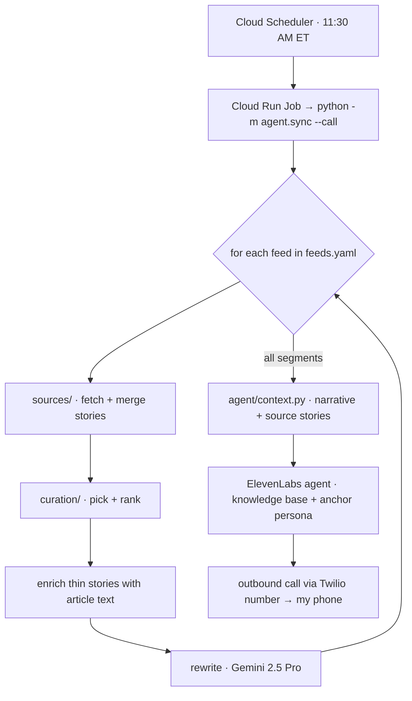

# Daily News Briefing

Every morning this app pulls the day's news from several sources, has an LLM curate it and rewrite
it into a spoken briefing, and then **phones me**. A conversational voice agent reads the briefing
and answers follow-up questions about any story. It runs on Google Cloud, so it doesn't depend on
my laptop.

The briefing has four segments, all configured in `feeds.yaml`:

| Segment | Sources |
| --- | --- |
| AI & Tech | TLDR AI (tldr.tech), Hacker News, Ars Technica / The Verge / TechCrunch RSS |
| US Headlines | NPR, CBS, ABC, The Hill RSS |
| Immigration & Visas | Guardian + Immigration Impact RSS, plus keyword-filtered politics feeds |
| Markets | S&P 500, Nasdaq, Dow + a watchlist (via `yfinance`) |

## How it works



1. **Fetch.** Each feed merges stories from its sources into a common `Story` shape. If one source
   fails, it's skipped and the rest still run.
2. **Curate.** A curator ranks and trims the candidates. `agentic` is a Google ADK agent that can
   fetch articles and check past digests; `deterministic` ranks by recency and keywords. If the
   agentic curator errors, it falls back to deterministic.
3. **Rewrite.** Gemini turns each segment into speech-ready prose at temperature 0.2. The prompts
   in `prompts/` stop it from inventing facts.
4. **Sync + call.** The composed narrative and the grounding stories are uploaded as the agent's
   knowledge doc for the day. ElevenLabs then rings `USER_PHONE_NUMBER`.

The original **MP3-by-email** path (`main.py`) still works: it rewrites the briefing, synthesizes
it with Cloud TTS (Chirp3-HD), and emails the clip. It's no longer what production runs, but it's
useful locally.

For the full picture (diagrams, patterns, how to extend), see [ARCHITECTURE.md](ARCHITECTURE.md).

## Quick start (local)

```bash
python -m venv .venv && .venv/bin/pip install -r requirements.txt
cp .env.example .env                      # fill in Gmail, GCP project, ElevenLabs keys
gcloud auth application-default login     # Vertex AI + TTS credentials
```

Then run whichever entry point you need:

```bash
# Phone-agent path (what production runs)
.venv/bin/python -m agent.sync --dry-run          # build + print today's knowledge doc, touch nothing
.venv/bin/python -m agent.sync                    # refresh the ElevenLabs agent's knowledge
.venv/bin/python -m agent.sync --call             # refresh, then ring USER_PHONE_NUMBER
.venv/bin/python -m agent.sync --call-only        # ring without rebuilding (telephony test)

# MP3-by-email path
DRY_RUN=1 .venv/bin/python main.py                # print the script, no audio/email
.venv/bin/python main.py                          # full: TTS + email

# Tests
.venv/bin/python -m pytest tests -q
```

`GMAIL_ADDRESS` and `GMAIL_APP_PASSWORD` are required by `config.py` on every path, the agent one
included.

## Deploy

```bash
export USER_PHONE_NUMBER='+1...'   # who the agent calls (kept out of the repo)
bash deploy.sh
```

`deploy.sh` enables the APIs, builds the image with Cloud Build, stores the Gmail and ElevenLabs
secrets in Secret Manager, grants the `vertex-ai-runner@` service account its roles (including
`cloudtrace.agent`), deploys the Cloud Run Job with its entrypoint overridden to
`python -m agent.sync --call`, and creates the Scheduler trigger (default `30 11 * * *`,
America/New_York).

You also need an ElevenLabs Conversational AI agent, and a Twilio number imported into ElevenLabs.
ElevenLabs places the call with that number's credentials, so the app never calls Twilio directly.

```bash
gcloud run jobs execute daily-news --region us-central1            # run now (refresh + call)
gcloud run jobs executions list --job daily-news --region us-central1
```

## Configuration

Feeds, sources, word budgets, and story caps live in **`feeds.yaml`**. To add a topic, add a feed
there plus a prompt in `prompts/`; no code changes are needed. Everything else is an environment
variable (see `.env.example`). The main ones:

| Variable | Purpose | Default |
| --- | --- | --- |
| `GMAIL_ADDRESS` / `GMAIL_APP_PASSWORD` | Gmail auth (SMTP for the email path; required everywhere) | — (required) |
| `GOOGLE_CLOUD_PROJECT` | GCP project for Vertex AI | — |
| `GEMINI_MODEL` | Curator + judges | `gemini-2.5-flash` |
| `GEMINI_REWRITE_MODEL` | Segment rewrite | `gemini-2.5-pro` |
| `REWRITE_TEMPERATURE` / `CURATOR_TEMPERATURE` | Kept low so the model paraphrases instead of inventing | `0.2` / `0.2` |
| `CURATOR` | `agentic` (ADK) or `deterministic` | `agentic` (`.env.example` sets `deterministic`) |
| `ENRICH_ARTICLES` / `ENRICH_MAX_PER_FEED` | Fetch article text for headline-only stories | on / `8` |
| `REALTIME_PROVIDER` | Voice-agent backend | `elevenlabs` |
| `ELEVENLABS_API_KEY` / `ELEVENLABS_AGENT_ID` / `ELEVENLABS_PHONE_NUMBER_ID` | The phone agent | — |
| `USER_PHONE_NUMBER` | Who the agent calls | — |
| `TTS_VOICE` / `TTS_MODEL` | Cloud TTS for the MP3 path | `en-US-Chirp3-HD-Charon` / stable voice |
| `TRACE_ENABLED` / `TRACE_BACKEND` | OpenTelemetry → Cloud Trace | on / `cloudtrace` |
| `GCS_BUCKET` | Optional archive | _(off)_ |
| `DRY_RUN` | Print instead of synthesize/send (`main.py`) | off |

## Evals

`evals/` grades segments against a **frozen golden set**: the day's captured sources, so a score
change reflects a code change rather than different news. There are two kinds of grading.

- **Reference-free** (no answer key needed): code checks for length, structure, and TTS safety,
  plus LLM judges for faithfulness, coverage, and relevance, and ADK's `hallucinations_v1`.
- **Reference-based**: graded against a hand-written `expectations.md` answer key, both as a whole
  and rule by rule as ADK rubrics.

```bash
python -m evals.capture --name YYYY-MM-DD                          # freeze today's sources
python -m evals.run --golden YYYY-MM-DD --curator agentic           # own judges
python -m evals.run --golden YYYY-MM-DD --curator agentic --adk-metrics   # + Google's ADK judges
python -m evals.compare --golden YYYY-MM-DD                         # deterministic vs agentic
```

## Observability

Each run is a single trace in Cloud Trace. ADK emits GenAI spans for the curator's model and tool
calls, raw `google-genai` calls are auto-instrumented, and `observability.py` adds spans for the
pipeline's own stages (gather, curate, enrich, rewrite, sync, call), with token counts on every
model call. No LangSmith or LangChain is involved.

To watch the curator agent turn by turn: `adk web adk_apps`.

## Project layout

| Path | Job |
| --- | --- |
| `agent/` | Phone-agent entry point (`sync.py`), knowledge doc (`context.py`), providers (ElevenLabs live; Gemini Live / Retell are stubs), anchor persona prompt |
| `main.py` | MP3-by-email entry point: TTS, email, GCS archive |
| `pipeline.py` | Gather → curate → enrich → rewrite → compose |
| `sources/` | One adapter per source: `tldr_web`, `hackernews`, `rss`, `stocks` (plus the unused `gmail_newsletter` and `google_news_rss`) |
| `curation/` | `deterministic.py` and `agentic.py` behind a shared `Curator` interface |
| `prompts/` | Per-feed rewrite and curation prompts + `_shared_style.md` |
| `composer.py` | Stitches segments into one script |
| `evals/` | Capture, checks, judges, ADK metrics, compare, golden sets |
| `observability.py` | Tracing bootstrap + span helpers |
| `adk_apps/` | Dev-only adapter that exposes the curator to `adk web` |
| `deploy.sh` / `Dockerfile` | Ship to Cloud Run |

`STATE.md` is my running dev log. `docs/field-notes.html` holds longer notes.
